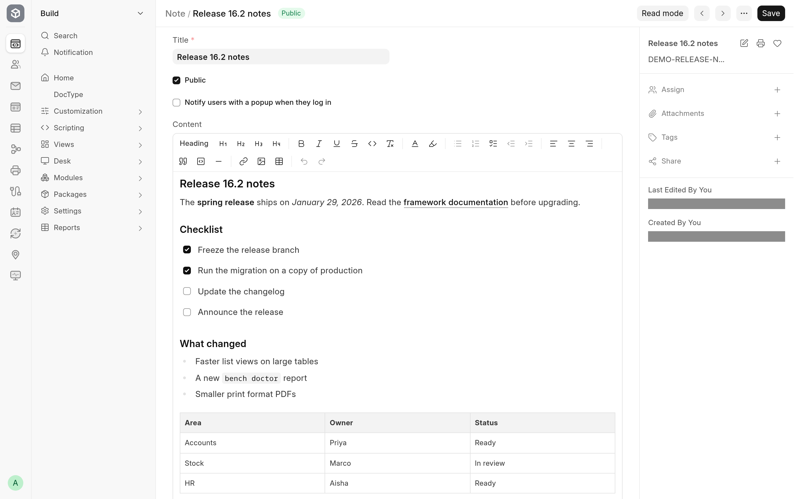

Every **Text Editor** field in the desk, such as a Note's content, a Task's description or the message of an email you compose, opens in the frappe-ui editor. You type into the field as before, and format with the toolbar above it or the menu that appears when you select text.

## The toolbar

The toolbar sits above the text. Its buttons show icons; hover over one to see its name. From left to right:

| Button                                            | What it does                                                                                              |
| ------------------------------------------------- | --------------------------------------------------------------------------------------------------------- |
| **Heading 1** to **Heading 4**                    | Turn the current paragraph into a heading of that level, or back into a paragraph when it already is one. |
| **Bold**, **Italic**, **Underline**, **Strike**   | Format the selected text.                                                                                 |
| **Code**                                          | Formats the selected text as inline code.                                                                 |
| **Clear formatting**                              | Removes the formatting of the selection and turns headings, lists and quotes back into plain paragraphs.  |
| **Font Color**                                    | Opens a picker with a **Text Color** and a **Background Color** row of swatches.                          |
| **Highlight**                                     | Highlights the selection in yellow, or removes the highlight.                                             |
| **Bullet List**, **Ordered List**, **Task list**  | Start or end a bulleted, numbered or check list. Task list items have a box you tick.                     |
| **Outdent**, **Indent**                           | Move the current list item one level out or in. They are greyed out where the item cannot move.           |
| **Align Left**, **Align Center**, **Align Right** | Align the current paragraph. Inside a table they align the cell.                                          |
| **Blockquote**                                    | Turns the paragraph into a quote.                                                                         |
| **Code block**                                    | Turns the paragraph into a block of preformatted code.                                                    |
| **Horizontal Rule**                               | Inserts a dividing line.                                                                                  |
| **Link**                                          | Adds or edits a link on the selected text. See [Links](#links).                                           |
| **Image / Gallery**                               | Opens a file picker for an image. See [Images](images.md).                                                |
| **Table**                                         | Opens a grid to choose the size of a new table. See [Tables](tables.md).                                  |
| **Undo**, **Redo**                                | Undo or redo your last change. They are greyed out when there is nothing to undo or redo.                 |

A highlighted button means the format is on where the cursor is.

The toolbar offers four heading levels. A value that Quill saved with a level 5 or 6 heading keeps it, because the editor reads all six levels.

## The selection menu

Select some text and a small menu appears next to it with **Bold**, **Italic**, **Underline**, **Strike** and **Link**, so you can format without going back to the toolbar.

## Links

1. Select the text that should become a link.
2. Click **Link** in the toolbar or in the selection menu.
3. Type or paste the address in the box (the placeholder shows `https://example.com`), and press Enter or click the check mark, whose name is **Apply**.

To change a link later, put the cursor in it and click **Link** again, or press Ctrl+K (Cmd+K on a Mac). The pop-up shows the address with **Copy link** and **Edit**; while you edit, **Remove link** turns the text back into plain text. Clicking a link places the cursor in it; Ctrl-click (Cmd-click on a Mac) opens it in a new tab.

## When the field is saved

What you type reaches the document 300 milliseconds after you stop typing, or as soon as you leave the field, the same delay the Quill editor used. Save the document as usual to keep it. Clicking into a field without changing anything does not mark the form as changed.

Scripts and style blocks are removed from the value before it is stored, as they were with Quill.

## Where the toolbar does not appear

- In a child table row, the field has no toolbar and no menus, because the row has no room for them. Open the row's form to format its text.
- In a read-only field, or a field of a submitted document, there is nothing to edit, so there is no toolbar.

## What the editor does not offer

The editor leaves out frappe-ui features that the desk's Text Editor never had or that would not work in the desk: `@` mentions, emoji, slash commands, video, file attachments other than images, image galleries and embedded pages (iframes). It also does not turn straight quotes and dashes into typographic ones as you type. See [Limitations](troubleshooting.md#limitations).
