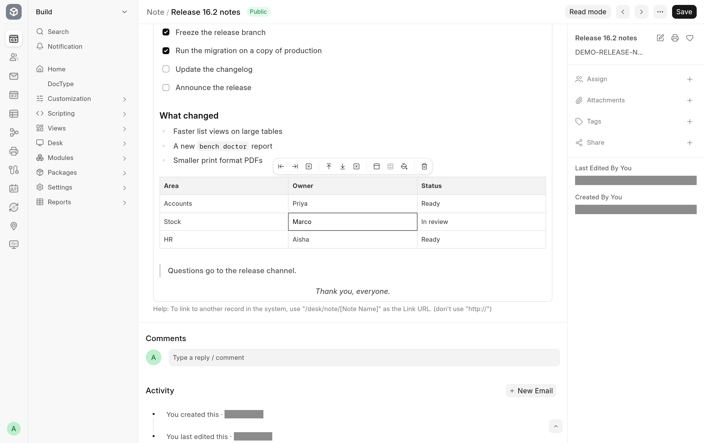

Quill's toolbar in the Frappe v16 desk can insert tables and add or delete rows and columns. The frappe-ui editor does that too, and adds a size picker, merged and split cells, cell colours and a header-row toggle. A table is stored as an ordinary HTML table in the field's value, so it shows in print formats and emails too.

## Insert a table

1. Put the cursor where the table should go.
2. Click **Table** in the toolbar. A grid opens.
3. Move over the grid to choose the number of rows and columns, and click.

The first row of a new table is a header row.

## Change a table

While the cursor is in a table, a bar of table controls appears with it.

| Control                                         | What it does                                                                                     |
| ----------------------------------------------- | ------------------------------------------------------------------------------------------------ |
| **Insert column left**, **Insert column right** | Add a column beside the current cell.                                                            |
| **Delete column**                               | Removes the column of the current cell.                                                          |
| **Insert row above**, **Insert row below**      | Add a row above or below the current cell.                                                       |
| **Delete row**                                  | Removes the row of the current cell.                                                             |
| **Toggle header row**                           | Makes the first row a header row, or an ordinary row again.                                      |
| **Merge cells** or **Split cell**               | Merges the selected cells into one, or splits a merged cell. The name changes with what applies. |
| **Cell color**                                  | Opens a picker for the cell's background and text colour.                                        |
| **Delete table**                                | Removes the whole table.                                                                         |

A control is greyed out when it does not apply where the cursor is. To select several cells, drag across them.

**Align Left**, **Align Center** and **Align Right** in the toolbar align the text of the current cell.

## Where tables are not available

The table controls are part of the toolbar, so they do not appear in a child table row or a read-only field. See [Where the toolbar does not appear](editing.md#where-the-toolbar-does-not-appear).
